# IDENTIPAT-IA

## Manual de usuario

**Identificación de modalidades de propiedad intelectual con inteligencia artificial**

**Versión 1.1 — preparada para diagramación, pendiente de validación institucional**

**Identificación documental:** pendiente de asignación institucional  
**Elaboración:** equipo del proyecto IDENTIPAT-IA  
**Revisión y aprobación:** pendientes de designación institucional

**Institución:** Instituto Nacional de Defensa de la Competencia y de la Protección de la Propiedad Intelectual — Indecopi

---

## Control de versiones

| Versión | Fecha | Descripción | Estado |
| --- | --- | --- | --- |
| 1.1 | 13 de noviembre de 2026 | Diagramación del manual institucional para revisión | Borrador para revisión institucional; no aprobado |

## Índice

1. [Introducción](#1-introducción)
2. [Objetivo, alcance y perfiles](#2-objetivo-alcance-y-perfiles)
3. [Requisitos y recomendaciones antes de empezar](#3-requisitos-y-recomendaciones-antes-de-empezar)
4. [Acceso e identificación STANDARD](#4-acceso-e-identificación-standard)
5. [Registro, términos y consentimiento](#5-registro-términos-y-consentimiento)
6. [Describir una creación](#6-describir-una-creación)
7. [Iniciar y seguir un análisis](#7-iniciar-y-seguir-un-análisis)
8. [Interpretar y descargar el diagnóstico](#8-interpretar-y-descargar-el-diagnóstico)
9. [Finalizar la sesión STANDARD](#9-finalizar-la-sesión-standard)
10. [Acceso y navegación ADMIN](#10-acceso-y-navegación-admin)
11. [Consultar predicciones](#11-consultar-predicciones)
12. [Consultar y administrar usuarios](#12-consultar-y-administrar-usuarios)
13. [Perfil y seguridad ADMIN](#13-perfil-y-seguridad-admin)
14. [Configuraciones institucionales](#14-configuraciones-institucionales)
15. [Errores frecuentes y recomendaciones de seguridad](#15-errores-frecuentes-y-recomendaciones-de-seguridad)
16. [Glosario](#16-glosario)
17. [Orientación y soporte](#17-orientación-y-soporte)

## 1. Introducción

IDENTIPAT-IA es una herramienta de orientación para identificar posibles modalidades de protección de propiedad intelectual relacionadas con una creación. Permite ingresar una descripción y consultar un diagnóstico con alternativas y orientación institucional asociada.

Los resultados son generados con inteligencia artificial y tienen carácter orientativo. Pueden contener errores, no constituyen decisiones oficiales de Indecopi y no reemplazan el juicio técnico ni la evaluación especializada. Verifique la información importante antes de tomar decisiones.

## 2. Objetivo, alcance y perfiles

Este manual explica cómo ingresar a la plataforma, describir una creación, revisar el diagnóstico y utilizar las secciones administrativas. Está dirigido a personas usuarias STANDARD y al personal ADMIN autorizado.

**STANDARD** se identifica mediante DNI o Carné de Extranjería (CE). No inicia sesión con contraseña y no cuenta con perfil ni historial visible en la plataforma. Sus análisis se asocian a la sesión activa.

**ADMIN** accede mediante documento y contraseña. El panel ofrece secciones de predicciones, gestión de usuarios, perfil y configuraciones. Las operaciones que pueden cambiar datos o reemplazar contenido institucional deben realizarlas únicamente administradores autorizados.

## 3. Requisitos y recomendaciones antes de empezar

- Acceso a internet y un navegador web actualizado.
- DNI o CE para identificar una cuenta STANDARD.
- Para registrarse, tener a mano los datos personales que solicita el formulario.
- Para ADMIN, contar con una cuenta administrativa y su contraseña.
- Para grabar voz, se requiere un dispositivo con micrófono y permiso del navegador.
- Antes de ingresar una descripción, revise los Términos de uso y la Política de Privacidad vigentes.

## 4. Acceso e identificación STANDARD

### 4.1 Abrir la plataforma

1. Abra **[URL institucional pendiente de confirmación]** desde un navegador actualizado. No distribuir este marcador como enlace de acceso.
2. En el bloque **Obten tu reporte accede aquí**, elija el tipo de documento: **DNI** o **CE**.
3. Escriba el número correspondiente y seleccione **Ingresar**.
4. Si necesita crear un registro, seleccione **Registrarme**.

**Figura 1. Acceso desde la portada.** La imagen conserva el contexto del llamado a ingresar y muestra los controles **Ingresar**, **Registrarme** y el vínculo a los términos.

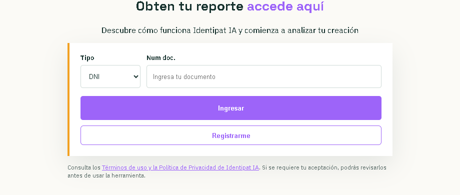

La pantalla indica que el DNI debe contener 8 dígitos y el CE entre 6 y 11. Si el formato no coincide, lea el aviso, corrija el dato y vuelva a seleccionar **Ingresar**. Un DNI/CE identifica una cuenta STANDARD: no es contraseña ni una credencial de acceso ADMIN.

**Figura 2. Validación del número de documento.** Ejemplo del mensaje de formato mostrado para un valor incompleto.

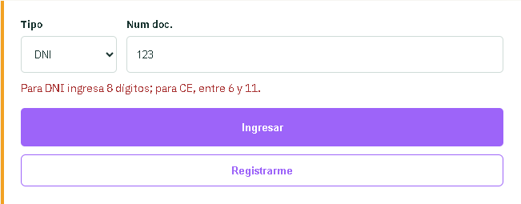

### 4.2 Acceso STANDARD reconocido

Cuando la plataforma reconoce una cuenta STANDARD, permite continuar al formulario de análisis. Si indica que el documento no corresponde a una cuenta registrada, utilice **Registrarme** y complete el alta; no pruebe contraseñas ni use el DNI como clave.

1. Confirme que **DNI** o **CE** corresponde al documento que utilizará.
2. Ingrese el número sin espacios adicionales y seleccione **Ingresar**.
3. Revise el resultado que presenta la pantalla. Si se reconoce el registro, espere a que abra el formulario de análisis.
4. Si no logra continuar, revise el mensaje y el formato antes de volver a intentarlo.

**Figura 3. Formulario de análisis de una sesión STANDARD.**

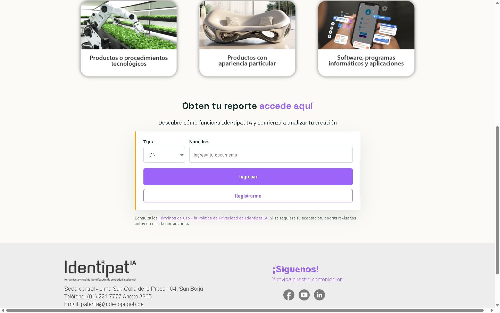

## 5. Registro, términos y consentimiento

### 5.1 Registrarse

El registro solicita nombres, apellidos, tipo y número de documento, fecha de nacimiento, género, correo, celular y profesión u ocupación.

1. En la portada, seleccione **Registrarme**.
2. Seleccione el tipo de documento y complete los datos solicitados: nombres, apellidos, documento, fecha de nacimiento, género, correo, celular y profesión u ocupación.
3. Revise cada campo y corrija los que la pantalla marque como inválidos. Complete los campos obligatorios.
4. Abra y lea **Términos de uso y Política de Privacidad**.
5. Marque la casilla de aceptación presentada en el formulario. Cuando el botón **Registrarme** esté habilitado, selecciónelo.
6. Lea el mensaje de la aplicación y siga las indicaciones para continuar.

Los ejemplos grises del formulario son textos de ayuda. Escriba sus propios datos; no envíe la pantalla con información de ejemplo.

**Figura 4. Campos y aceptación del formulario de registro.**

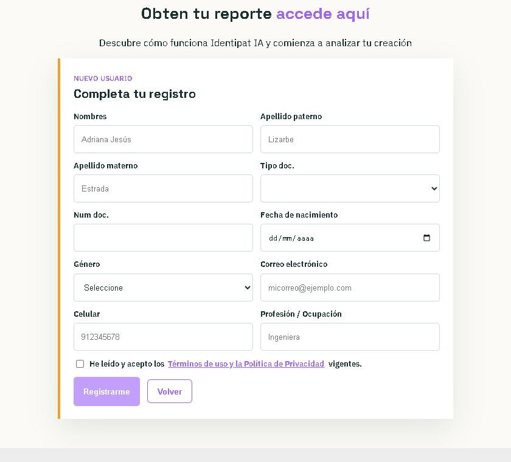

Si un campo no cumple el formato esperado, revise el mensaje que muestra la plataforma.

**Figura 5. Ejemplo de validación del registro.**

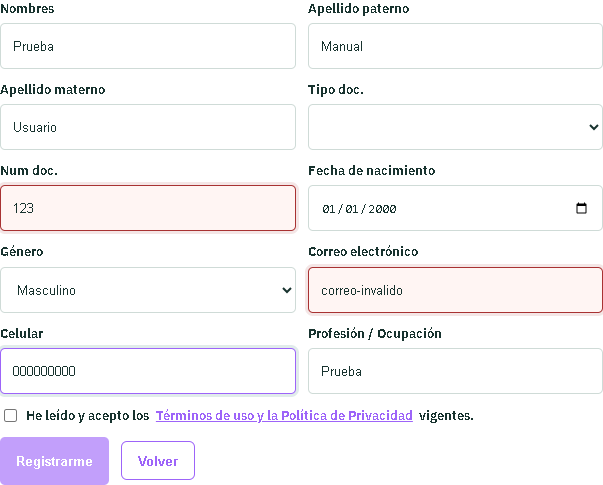

### 5.2 Términos, privacidad y consentimiento

Puede consultar los **Términos de uso y la Política de Privacidad** desde el vínculo de la portada. Abra el documento, revise su fecha de actualización y lea el contenido antes de proporcionar información.

Registrarse, identificarse y otorgar consentimiento son acciones distintas. Si la aplicación solicita consentimiento, lea el documento legal vigente y su fecha. Marque **He leído y acepto expresamente los Términos de uso y la Política de Privacidad vigentes** y seleccione **Aceptar y continuar** si desea aceptar. Si no acepta, seleccione **No aceptar** y siga las opciones que presenta la aplicación. No marque la casilla en nombre de otra persona.

**Figura 6. Documento legal público.**

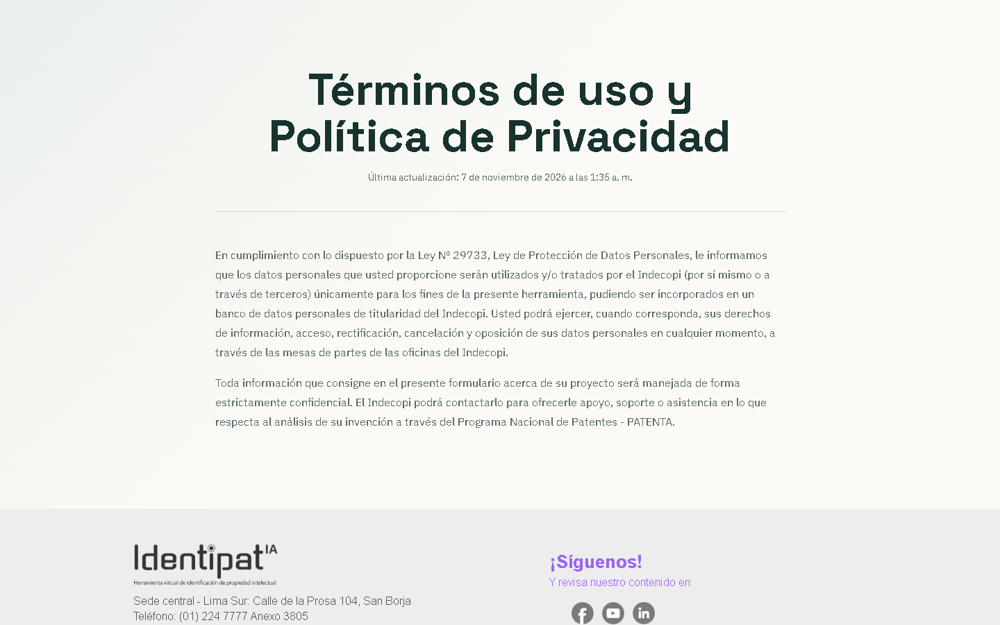

## 6. Describir una creación

Al ingresar, se muestra **Cuéntanos qué quieres proteger** y el campo **Descripción de la creación**. Antes de escribir, reúna información que ayude a explicar la creación: qué es, qué necesidad atiende, cómo funciona, cuáles son sus partes o pasos principales y qué característica considera distinta. Use lenguaje directo y concreto; describa la creación completa y evite afirmaciones que no pueda sustentar. No incluya datos personales innecesarios ni información confidencial que no desee procesar. La orientación dependerá de la información que proporcione.

### 6.1 Ingresar texto

1. En **Descripción de la creación**, explique el propósito y funcionamiento de la creación.
2. Añada los componentes o pasos principales, cómo se relacionan y qué diferencia considera relevante.
3. Revise que el texto sea comprensible y corresponda a una sola creación. Quite información personal innecesaria.
4. La aplicación valida entre 20 y 20 000 caracteres. Si aparece el aviso de longitud, complete o reduzca el texto hasta quedar dentro de ese intervalo.
5. Seleccione **Iniciar análisis** una sola vez y espere el estado de procesamiento.

**Resultado esperado:** la pantalla indica que el análisis se está realizando y, al completarse, presenta el resultado asociado a esa solicitud.

**Figura 7. Formulario de análisis.** Se observan las opciones de texto, **Grabar voz** y **Adjuntar PDF**, además de la advertencia de que la inteligencia artificial puede cometer errores.

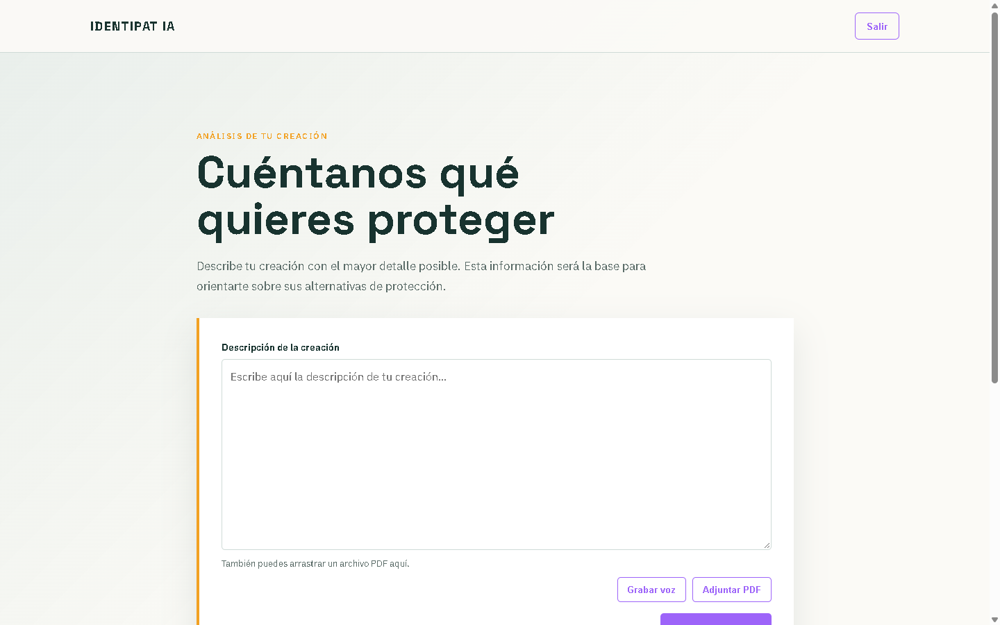

**Figura 8. Descripción de ejemplo antes de iniciar el análisis.**

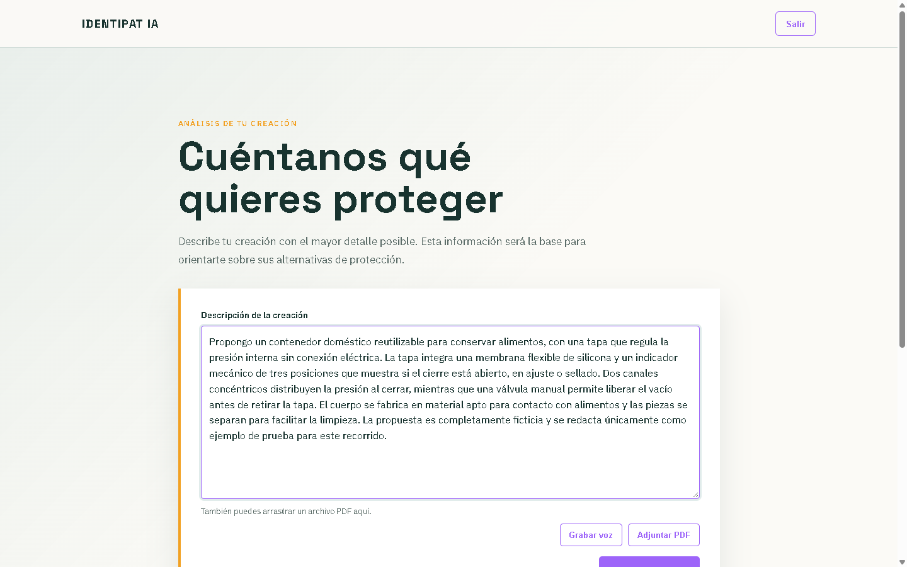

### 6.2 Adjuntar un documento PDF

La pantalla permite seleccionar **Adjuntar PDF** o arrastrar un archivo al área de ingreso. El archivo debe ser un PDF válido y no puede superar 10 MiB.

1. Prepare un archivo que termine en PDF y no supere 10 MiB.
2. Seleccione **Adjuntar PDF** y elija el archivo, o arrástrelo al área indicada.
3. Compruebe que se muestra el archivo esperado. Si eligió el incorrecto, use **Quitar archivo PDF** y vuelva a seleccionar.
4. Revise que el documento contenga la descripción que quiere analizar y que tiene autorización para procesarlo.
5. Seleccione **Iniciar análisis** cuando esté listo.

Cuando el documento aparezca como adjunto, revise que seleccionó el archivo correcto antes de continuar.

**Figura 9. Archivo PDF seleccionado.**

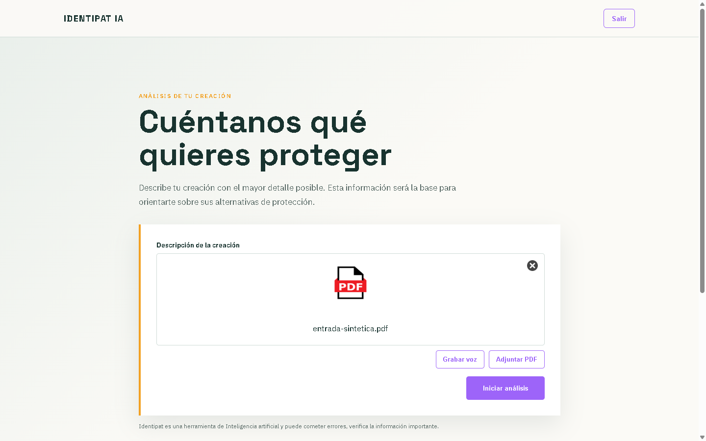

### 6.3 Ingreso por voz

El formulario presenta **Grabar voz**. Para ingresar una descripción por voz, compruebe que el equipo tenga micrófono y selecciónelo. Si el navegador solicita permiso, permita el acceso solo si desea grabar. Siga los controles que aparezcan durante la grabación y revise el audio antes de iniciar el análisis. Si no desea conceder permiso, cierre el aviso del navegador y utilice texto o PDF.

## 7. Iniciar y seguir un análisis

1. Verifique el texto o archivo seleccionado y confirme que es el material correcto.
2. Seleccione **Iniciar análisis** una sola vez. Durante el envío, el botón indica **Enviando...** y la aplicación muestra **Analizando con IA**.
3. Espere a que la solicitud termine. No recargue la página ni inicie otro análisis para repetir una solicitud que aparece en curso.
4. Si la pantalla ofrece **Reanudar seguimiento**, úselo para continuar consultando la solicitud pendiente.
5. Si el resultado indica que no se pudo completar el análisis, lea el mensaje visible y siga sus indicaciones. Evite reenviar repetidamente la misma solicitud.

**Figura 10. Análisis en procesamiento.** El estado mostrado indica que la solicitud está siendo revisada.

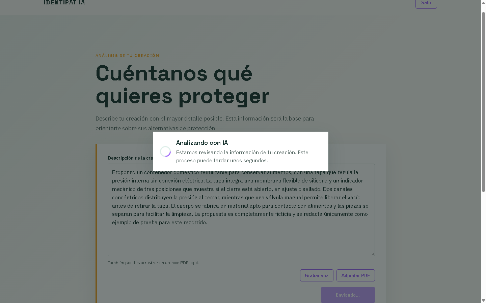

Al terminar, la plataforma abre el resultado disponible para esa sesión. Si aparece un mensaje de error, lea el texto y siga la indicación mostrada antes de intentar nuevamente.

## 8. Interpretar y descargar el diagnóstico

### 8.1 Leer el resultado

El reporte presenta información según el análisis recibido. El ejemplo de este manual describe una creación sintética e identifica **Modelo de utilidad** con la relación «Se relaciona claramente». Sirve para mostrar cómo leer la pantalla; sus conclusiones no representan resultados garantizados para otras personas o creaciones.

Para leer el resultado, avance en este orden:

1. **Fecha del análisis:** indica cuándo se completó el análisis. Úsela para identificar el reporte; no es una fecha de solicitud formal de protección.
2. **Resumen:** ofrece una síntesis automática de la información que recibió el sistema.
3. **Modalidades identificadas:** el número indica cuántas opciones aparecen en el reporte. Puede ser cero o más; no equivale a una concesión ni a una evaluación oficial.
4. **Modalidad de protección:** lea el nombre de cada opción y la etiqueta de relación o aplicabilidad que muestra la pantalla. En el ejemplo aparece Modelo de utilidad y «Se relaciona claramente».
5. **¿Cómo se relaciona con tu creación?** Este apartado describe la relación que el sistema identifica entre la creación y la modalidad.
6. **Fundamento de identificación:** «¿Por qué se identificó?» resume la razón generada para incluir esa opción.
7. **Orientación diagnóstica:** presenta información complementaria asociada a la modalidad, cuando esté disponible.
8. **Información complementaria:** según el caso, puede incluir screening de patentes, antecedentes históricos de patentabilidad o información sobre recursos genéticos. Puede no aparecer.
9. **Aspectos a considerar y advertencias:** lea todos los puntos que aparezcan; señalan limitaciones o información que requiere atención y no deben omitirse al interpretar el resumen.
10. **Próximos pasos:** abra el botón de la modalidad que desea consultar. Revise el contenido institucional y seleccione **Cerrar** para volver al resultado. Puede no haber orientación disponible.
11. **Disclaimer:** lea íntegramente el aviso institucional presentado en el reporte. El sistema advierte que el análisis es orientativo, puede contener errores y no reemplaza juicio técnico, evaluación experta ni decisiones oficiales de Indecopi. No constituye por sí solo una evaluación de patentabilidad ni una decisión sobre derechos.

**Figura 11. Resumen del diagnóstico.**

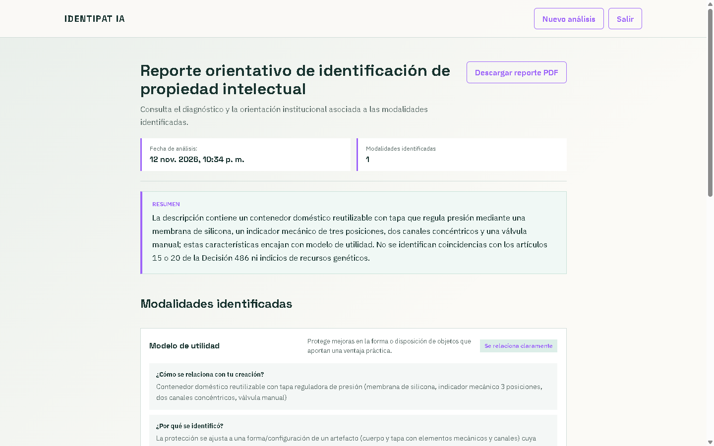

**Figura 12. Modalidades identificadas en el ejemplo.**

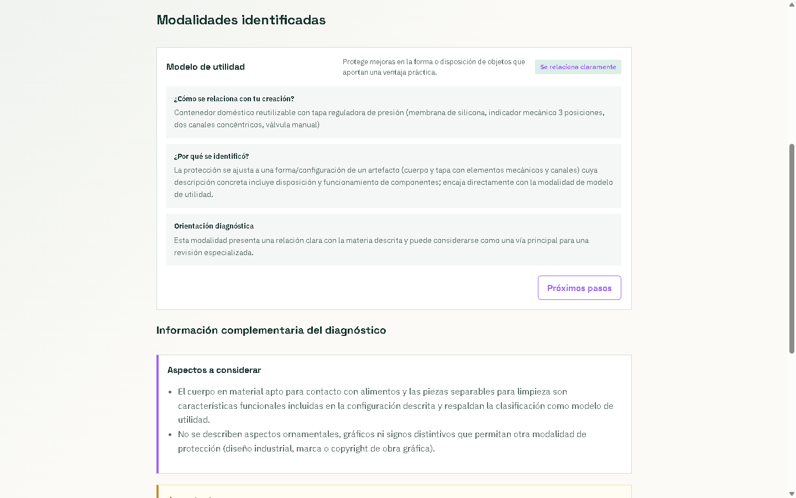

**Figura 13. Orientación diagnóstica del ejemplo.**

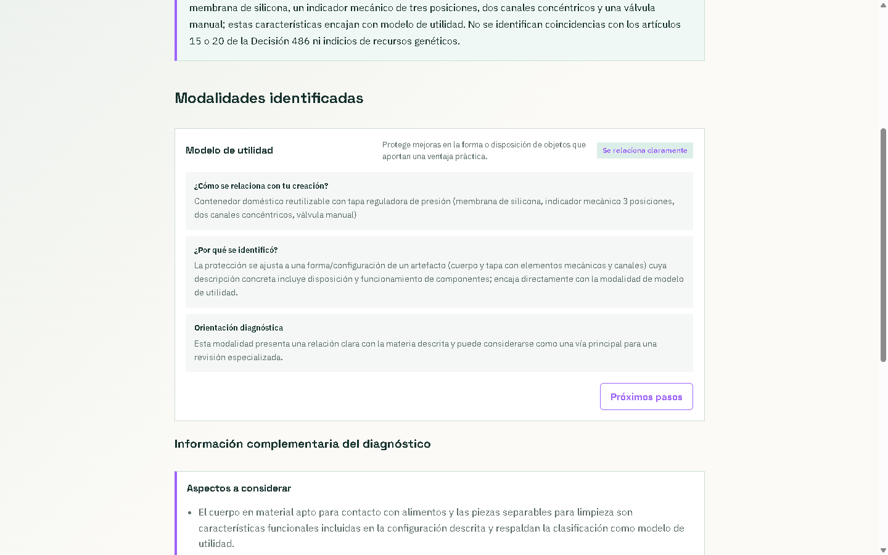

El análisis depende de la información ingresada y de las capacidades y límites de la inteligencia artificial. Puede omitir alternativas, identificar relaciones incorrectas o presentar errores. No resuelve la titularidad ni garantiza que una modalidad sea concedida. Contraste la información importante con fuentes oficiales y especialistas antes de actuar.

### 8.2 Revisar próximos pasos

Si está disponible, seleccione **Próximos pasos** para consultar la orientación institucional asociada a una modalidad. Use **Cerrar** para volver al reporte.

**Figura 14. Próximos pasos.**

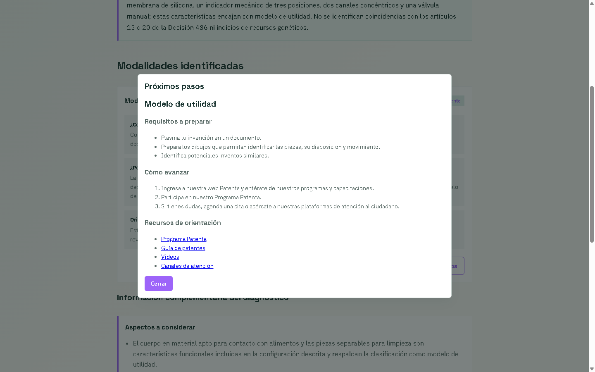

### 8.3 Descargar el reporte

1. En el reporte, seleccione **Descargar reporte PDF**.
2. Espere la descarga y abra el archivo desde el navegador o la carpeta de descargas.
3. Compruebe que se trata del reporte que desea conservar y lea el disclaimer incluido.
4. Guarde el archivo en un lugar protegido y compártalo solo con personas autorizadas.

Si la descarga falla, lea el mensaje «No se pudo descargar el reporte PDF. Inténtalo nuevamente.» y vuelva a intentarlo una vez. Si persiste, conserve la pantalla y contacte el canal institucional que se confirme para la publicación.

**Figura 15. Descarga del reporte.** La pantalla muestra la acción **Descargar reporte PDF**.

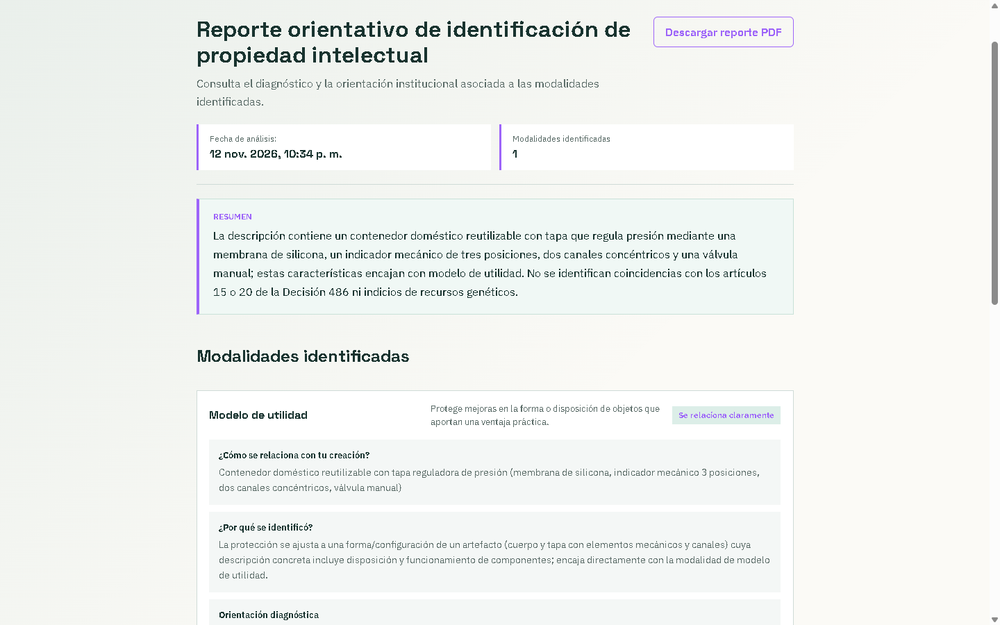

**Figura 16. Extracto del reporte de diagnóstico.** Incluye el aviso institucional y el resultado del ejemplo de Modelo de utilidad.

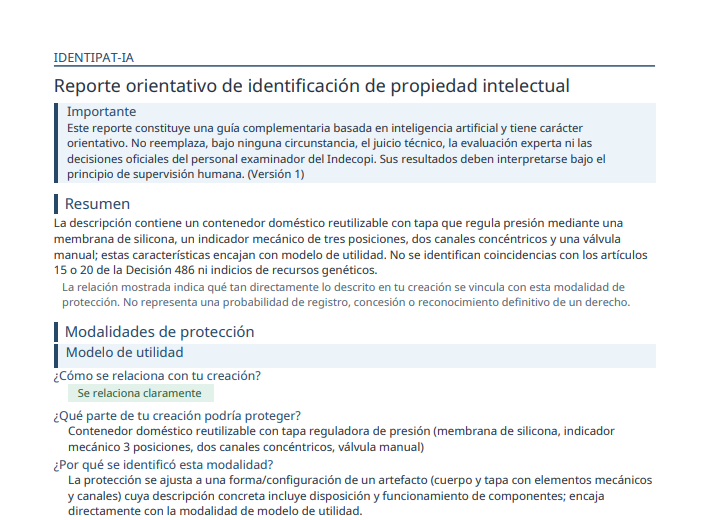

El reporte incluye el disclaimer institucional asociado. El resultado es complementario y orientativo: no reemplaza el juicio técnico, una evaluación experta ni decisiones oficiales del personal examinador de Indecopi.

## 9. Finalizar la sesión STANDARD

La pantalla de análisis y la vista del reporte incluyen **Salir**. Cuando termine, selecciónelo y siga el mensaje que presenta la aplicación. El cierre no elimina archivos descargados previamente. En la vista de resultado, **Nuevo análisis** inicia otra solicitud y no equivale a salir.

## 10. Acceso y navegación ADMIN

### 10.1 Iniciar sesión como ADMIN

1. En la pantalla de identificación, seleccione el tipo de documento de la cuenta administrativa autorizada e ingrese su número.
2. Seleccione **Ingresar**.
3. Cuando aparezca **Ingresa como administrador**, escriba la contraseña de la cuenta y seleccione **Acceder como administrador**.
4. Si la autenticación es aceptada, desde la vista de análisis seleccione **Panel de administración**.
5. Confirme que se abre el panel con sus secciones. Si el acceso se rechaza, no comparta ni registre la contraseña; solicite ayuda por el canal interno autorizado.

**Figura 17. Acceso administrativo.** Mantenga la contraseña en privado.

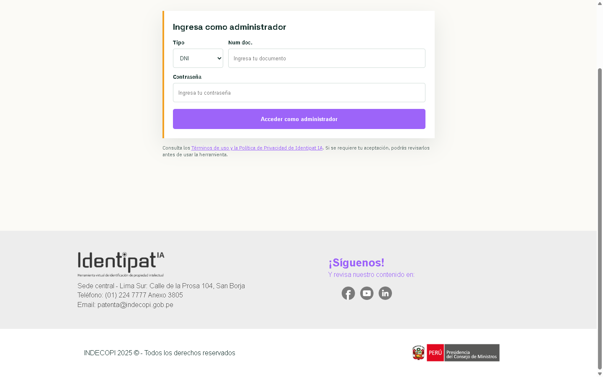

El panel organiza las funciones en **Predicciones**, **Gestión de usuarios**, **Perfil** y **Configuraciones**. Use **Cerrar sesión** al terminar el trabajo administrativo.

## 11. Consultar predicciones

La sección **Predicciones** muestra fecha, nombres, apellidos, conclusión, modalidades identificadas y si se consultó orientación. Incluye controles de texto, fecha inicial/final, tamaño de página, búsqueda, actualización, paginación y descarga. Estas filas pueden contener datos personales y contenido derivado de análisis; acceda solo para una tarea autorizada y proteja la información.

1. Abra **Predicciones** y espere a que se cargue el listado.
2. Para filtrar por palabras, ingrese el criterio en **Buscar** y seleccione **Buscar**. Los campos visibles permiten buscar por nombre, apellidos, documento o correo; utilice solo criterios necesarios para su función.
3. Si corresponde, indique **Fecha inicio** y **Fecha fin** y revise el rango antes de buscar.
4. En **Mostrar**, elija 5, 10, 20, 50 o 100 filas por página.
5. Revise la tabla. Use **Anterior** o **Siguiente** para recorrer páginas y **Refrescar** para solicitar nuevamente el listado.

Los criterios y resultados deben corresponder a la tarea autorizada. Si necesita utilizar el listado para una decisión operativa, confirme que los filtros y el rango sean los requeridos.

**Figura 18. Historial de predicciones.**

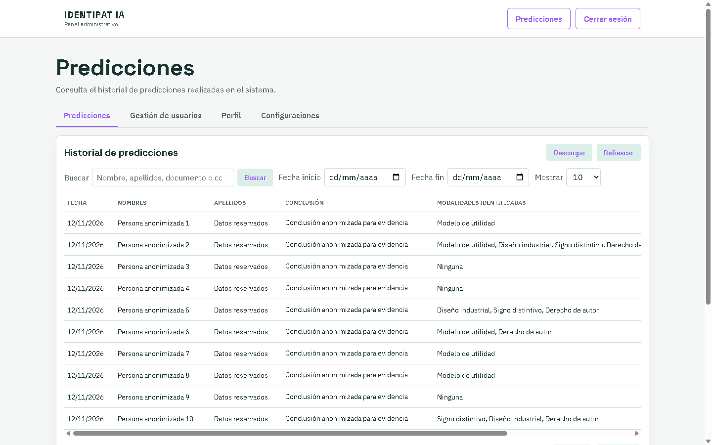

El botón **Descargar** aparece junto a la tabla. Utilícelo únicamente cuando la exportación corresponda a una tarea autorizada. Siga las reglas institucionales de protección y conservación de datos para el archivo obtenido.

## 12. Consultar y administrar usuarios

En **Gestión de usuarios**, la tabla presenta identificadores, datos de perfil, tipo de cuenta, estado y acciones. Los filtros visibles incluyen **Buscar**, **Estado**, **Tipo** y **Mostrar**; también se ven **Buscar**, **Refrescar**, **Descargar** y controles de paginación.

1. Abra **Gestión de usuarios** y espere el listado.
2. Escriba un criterio en **Buscar** y seleccione **Buscar** para localizar por nombre, documento o correo.
3. Seleccione **Estado** —Todos, Activos o Inactivos— y/o **Tipo** —Todos, Estándar o Administradores— según su tarea.
4. Elija el número de filas en **Mostrar**. Revise la página actual y use **Anterior** o **Siguiente** para recorrer los resultados; use **Refrescar** para cargar de nuevo.
5. La tabla muestra los registros que coinciden y ofrece **Editar** por fila. Abra la edición únicamente con autorización expresa y siga el procedimiento institucional aprobado.

Consulte solo registros necesarios para su función y proteja los datos personales que aparecen en la tabla.

**Figura 19. Gestión de usuarios.**

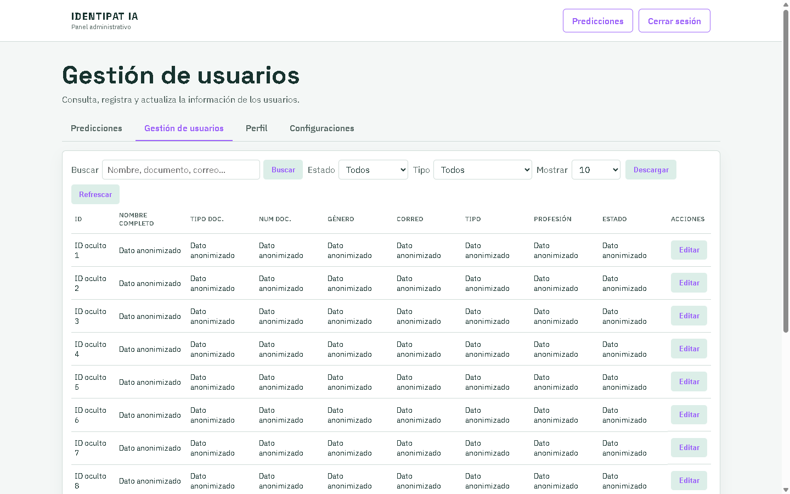

La actualización de datos, tipo o estado de una cuenta requiere autorización y debe seguir el procedimiento administrativo vigente. Si no cuenta con esas instrucciones, consulte a la persona responsable antes de seleccionar **Editar** o guardar cambios.

## 13. Perfil y seguridad ADMIN

En **Perfil** se muestran el tipo y estado de la cuenta y campos de nombres, apellidos, fecha de nacimiento, género, correo, celular y profesión. El botón **Actualizar mis datos** aparece debajo.

**Figura 20. Datos del perfil ADMIN.**

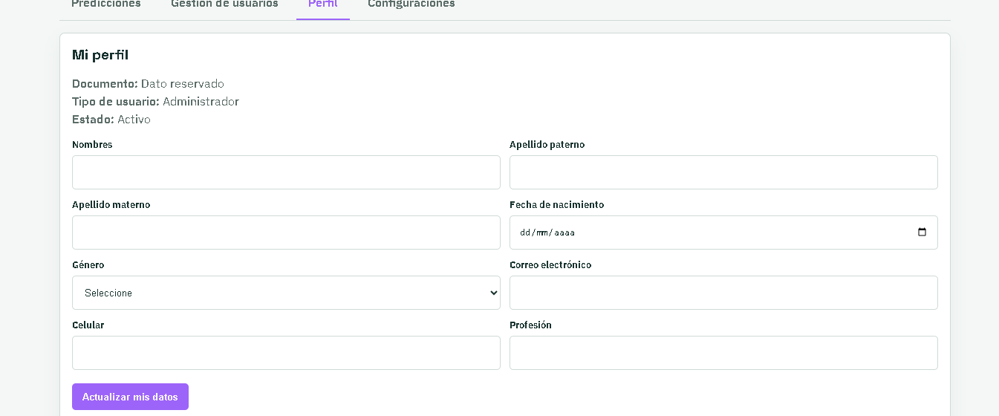

En **Seguridad** se muestran **Contraseña nueva**, **Confirmar contraseña nueva**, **Mostrar contraseña** y **Actualizar contraseña**.

**Figura 21. Controles de seguridad ADMIN.**

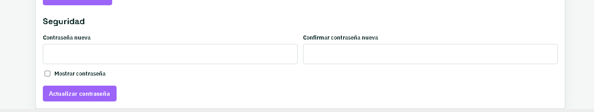

Antes de actualizar los datos o la contraseña, consulte el procedimiento aprobado por la institución. No comparta contraseñas por correo o mensajería. La recuperación de contraseña debe seguir el canal institucional autorizado.

## 14. Configuraciones institucionales

### 14.1 Orientaciones por modalidad

La sección **Configuraciones** agrupa orientaciones para **Patente de invención**, **Modelo de utilidad**, **Diseño industrial**, **Derecho de autor**, **Signo distintivo**, **Certificado de obtentor** y **Secreto empresarial**. Junto a cada modalidad se muestra su estado actual.

**Figura 22. Estados de las orientaciones.** La vista muestra el estado **Activo** en las siete modalidades.

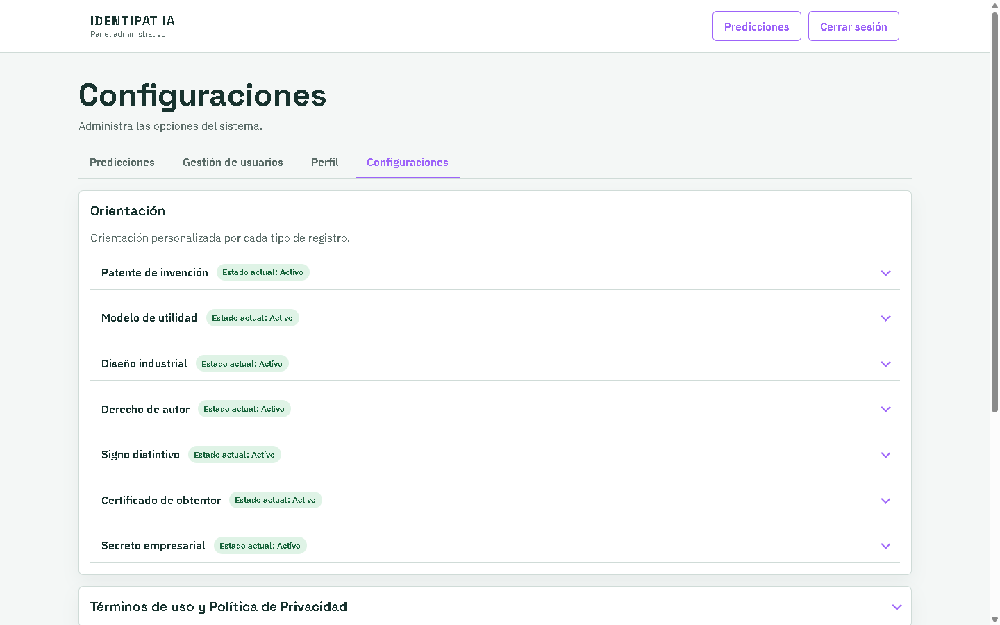

Para consultar una orientación, expanda la modalidad por su nombre y lea la descripción, el estado y el contenido presentado. En Patente de invención, el panel también presenta un editor y el control **Guardar borrador**.

El panel presenta **Guardar borrador** y, cuando hay un borrador, **Publicar**. Antes de guardar o publicar una orientación, siga el flujo de revisión y autorización institucional: la publicación reemplaza el contenido activo. El diálogo presenta **Cancelar** y **Confirmar publicación**.

**Figura 23. Editor de orientación para Patente de invención.** La figura muestra el contenido activo y el control de borrador.

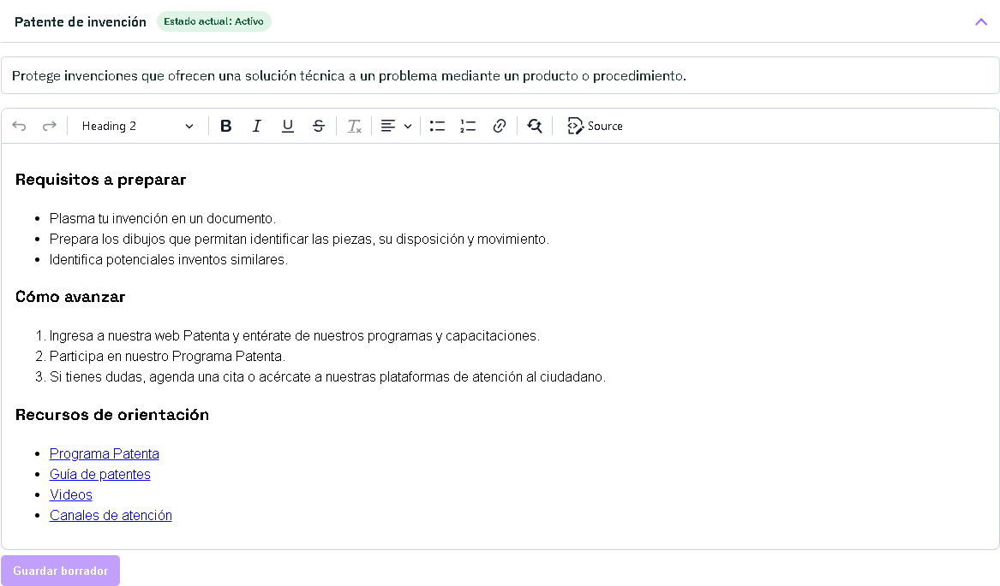

La edición y publicación pueden sustituir contenido institucional. Hágalo únicamente con autorización y siguiendo el flujo aprobado.

### 14.2 Términos de uso y Política de Privacidad

1. Expanda **Términos de uso y Política de Privacidad**.
2. Consulte el título, contenido y fecha de actualización.
3. No cambie el contenido desde el panel salvo que exista una versión aprobada y autorización institucional.

El panel presenta **Guardar cambios**. La actualización del documento legal requiere revisión y aprobación del área responsable. Mantenga íntegro el sentido aprobado de sus términos y política de privacidad.

**Figura 24. Documento legal en Configuraciones.**

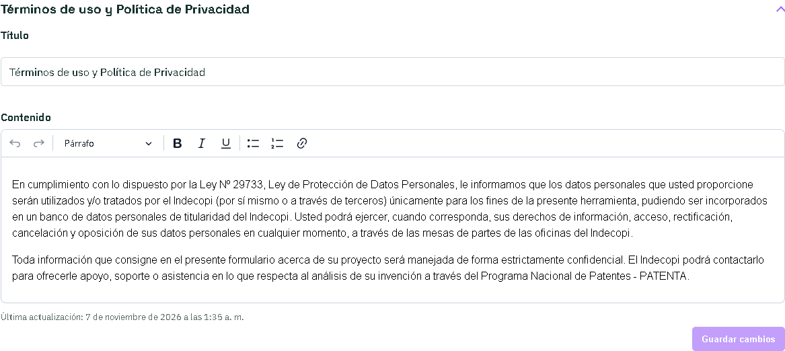

### 14.3 Disclaimer institucional

1. Expanda **Disclaimer Institucional** y lea el título y el texto cargados.
2. Preserve el sentido íntegro del disclaimer institucional: el reporte es complementario y orientativo, no reemplaza juicio técnico ni evaluación experta, y se interpreta bajo supervisión humana; tampoco equivale a una decisión oficial.
3. No edite ni guarde contenido sin la versión aprobada por el área responsable.

El panel presenta **Guardar borrador** y, si hay un borrador, **Publicar**. El diálogo indica que publicar reemplazará el disclaimer activo y ofrece **Cancelar** o **Confirmar publicación**. Conserve íntegro el sentido del aviso institucional y solicite aprobación antes de guardar o publicar cambios.

**Figura 25. Disclaimer Institucional.**

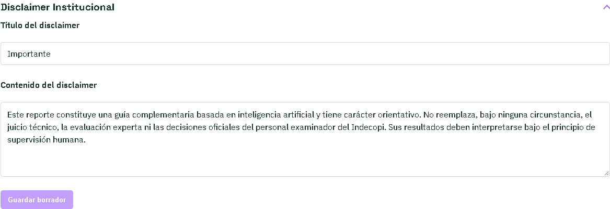

La publicación de orientaciones o disclaimers puede reemplazar una versión activa. No publique cambios sin las aprobaciones y revisiones previstas.

## 15. Errores frecuentes y recomendaciones de seguridad

| Situación | Qué hacer |
| --- | --- |
| El documento no continúa | Confirme que eligió DNI o CE y que cumple la longitud indicada en pantalla (DNI: 8 dígitos; CE: 6–11). Revise el aviso. Si el documento no corresponde a una cuenta registrada, use **Registrarme**. |
| La cuenta STANDARD no se reconoce | Revise el tipo y número del documento. Si todavía no tiene un registro, seleccione **Registrarme** y siga el formulario. No use el documento como contraseña ni como acceso ADMIN. |
| Hay campos obligatorios o inválidos en el registro | Complete los campos requeridos y corrija los que aparecen marcados. El botón puede permanecer deshabilitado hasta que el formulario sea válido. |
| Se requiere consentimiento | Lea el documento vigente y decida. La aplicación solo habilita **Aceptar y continuar** tras marcar la casilla. Si no acepta, puede seleccionar **No aceptar** y salir. |
| La sesión parece no estar disponible | Lea el mensaje visible y siga las indicaciones que presente la aplicación. Si no puede continuar, regrese a la portada institucional o consulte el canal de soporte aprobado. |
| La descripción no se puede enviar | Revise que tenga entre 20 y 20 000 caracteres y lea el mensaje debajo del campo. |
| PDF incompatible o grande | Compruebe que sea un archivo PDF válido y no exceda 10 MiB. La interfaz contiene los avisos «Selecciona un archivo PDF válido» y «El PDF no puede superar los 10 MiB». Retírelo y seleccione el archivo correcto. |
| No se puede acceder al micrófono | Si desea grabar, revise los permisos del navegador y que el dispositivo tenga micrófono. Si aparece «No se pudo acceder al micrófono. Revisa los permisos del navegador», revise los permisos o utilice otra modalidad. |
| El análisis sigue en curso | Espere la misma solicitud. Si aparece **Reanudar seguimiento**, selecciónelo; no envíe repetidamente el mismo material. |
| El análisis falla | La aplicación presenta «No se pudo completar el análisis» y un mensaje asociado. Léalo y solicite ayuda si persiste; no se documenta una causa única ni una solución garantizada. |
| No se descarga el reporte | Si aparece el aviso de descarga fallida, inténtelo nuevamente una vez. Si persiste, contacte el canal institucional que se confirme. |
| Acceso ADMIN no autorizado | Compruebe que está en el acceso de administrador e ingrese credenciales autorizadas. No intente eludir el acceso ni use credenciales de terceros; solicite asistencia interna. |

- Proteja su DNI, CE, datos de contacto y contraseña.
- No envíe datos personales de terceros ni archivos que no tenga autorización para procesar.
- En el panel ADMIN, limite consultas y exportaciones al trabajo autorizado.
- Revise siempre los mensajes y el documento legal que presenta la aplicación.
- Contraste los resultados importantes con fuentes oficiales o asesoría especializada.

## 16. Glosario

| Término | Significado en esta guía |
| --- | --- |
| ADMIN | Perfil administrativo con acceso por documento y contraseña a las secciones de administración. |
| CE | Carné de Extranjería, opción de documento disponible en la pantalla de acceso. |
| Disclaimer | Aviso que explica el carácter, alcance y límites del reporte. |
| Modalidad de protección | Categoría de propiedad intelectual que puede relacionarse con una creación, como patente, diseño industrial o derecho de autor. |
| STANDARD | Perfil de usuario que se identifica con DNI o CE y utiliza el análisis sin contraseña. |
| Orientación diagnóstica | Información complementaria del análisis sobre posibles opciones de protección. Tiene carácter orientativo. |

## 17. Orientación y soporte

**Canal institucional aprobado:** correo y teléfono pendientes de confirmación.

---

**Estado:** versión preparada para revisión institucional. La URL, los datos de contacto y las aprobaciones indicadas en este documento requieren confirmación antes de su distribución.
